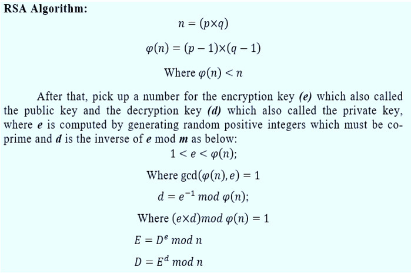

# RSA (Rivest–Shamir–Adleman)

*The original public-key algorithm: encrypt with a public key, decrypt with the
private one, sign with the private key. Its security comes from how hard it is to
factor a large number.*

## What it is

RSA, published in 1977, was the first practical public-key scheme and still shows
up everywhere in TLS certificates and signatures. The public key `(n, e)` is
shared freely; the private key `(n, d)` is kept secret. Anyone can encrypt to you
or verify your signature with the public key, but only you can decrypt or sign.

Security rests on the factoring problem: `n` is the product of two large secret
primes `p` and `q`, and recovering them from `n` is infeasible at modern sizes.

## How it works

Key generation:

1. Pick two large random primes `p`, `q` and set `n = p·q`.
2. Compute `φ(n) = (p−1)(q−1)`.
3. Choose `e` coprime to `φ(n)` — almost always 65537.
4. Compute the private exponent `d = e⁻¹ mod φ(n)`.

Then for `0 ≤ m < n`:

- **Encrypt:** `c = mᵉ mod n`  **Decrypt:** `m = c^d mod n`
- **Sign:** `s = m^d mod n`  **Verify:** `m == sᵉ mod n`

It works because raising to `e` then `d` is the identity mod `n` (Euler's theorem).



## When to use it

- Fine for certificates and signatures, but new systems increasingly prefer
  elliptic curves ([Ed25519](EdDSA.md), [ECDSA](ECDSA.md)) for smaller, faster keys.
- **Always use padding** — OAEP for encryption, PSS for signatures. Textbook RSA
  (raw `mᵉ`) is insecure: deterministic and malleable.
- RSA can only encrypt data smaller than the key, so it wraps a symmetric key
  rather than bulk data. See [symmetric vs. asymmetric](../FAQ.md).
- 2048-bit minimum (~112-bit security); 3072-bit for longer horizons.

## Example (Python)

Concise core showing the math. In production use a vetted library (PyCA
`cryptography`) that handles OAEP/PSS padding and safe key sizes.

```python
def keygen(p, q, e=65537):              # real keygen picks p, q at random
    n, phi = p * q, (p - 1) * (q - 1)
    return (n, e), (n, pow(e, -1, phi))

def encrypt(m, pub):  n, e = pub;  return pow(m, e, n)
def decrypt(c, priv): n, d = priv; return pow(c, d, n)
```

Real prime generation uses [Miller-Rabin](../10-math-foundations/Miller-Rabin-Primality-Test.md).

## Going deeper

Each part below starts closed; open the ones you want.

??? example "Sample calculation: RSA with small numbers"

    Real RSA uses primes hundreds of digits long. With tiny primes every step fits on one line (the textbook
    example; checked with Python's `pow`):

    | Step | Calculation | Value |
    |---|---|---|
    | 1. Pick two primes | `p = 61`, `q = 53` | |
    | 2. Modulus | `n = p·q = 61 × 53` | `n = 3233` |
    | 3. Totient | `φ(n) = (p−1)(q−1) = 60 × 52` | `φ(n) = 3120` |
    | 4. Public exponent | `e = 17` (shares no factor with 3120) | `e = 17` |
    | 5. Private exponent | `d = 17⁻¹ mod 3120` | `d = 2753` |
    | Check | `e·d = 17 × 2753 = 46801 = 15 × 3120 + 1` | `e·d mod φ(n) = 1` |
    | Encrypt `m = 65` | `c = 65¹⁷ mod 3233` | `c = 2790` |
    | Decrypt | `m = 2790²⁷⁵³ mod 3233` | `m = 65` |
    | Sign `m = 65` | `s = 65²⁷⁵³ mod 3233` | `s = 588` |
    | Verify | `588¹⁷ mod 3233` | `65`, so the signature is good |

    Public key `(3233, 17)`, private key `(3233, 2753)`. Anyone can factor 3233 in an instant, which is why
    real keys use a 2048-bit or larger `n`.

??? abstract "The math, with formulas"

    **Finding `d` (extended Euclidean algorithm).** Divide until the remainder is 1, then work back up:

    ```
    3120 = 183 × 17 + 9
      17 =   1 × 9  + 8
       9 =   1 × 8  + 1
    1 = 9 − 8 = 9 − (17 − 9) = 2·9 − 17 = 2·(3120 − 183·17) − 17 = 2·3120 − 367·17
    ```

    So `−367·17 ≡ 1 (mod 3120)`, and `d = −367 + 3120 = 2753`.

    **Why decryption undoes encryption.** `e·d = 1 + k·φ(n)` for some whole number `k`. Euler's theorem says
    `m^φ(n) ≡ 1 (mod n)` when `m` shares no factor with `n`, so

    ```
    c^d = (m^e)^d = m^(e·d) = m^(1 + k·φ(n)) = m · (m^φ(n))^k ≡ m · 1^k = m   (mod n)
    ```

    The Chinese remainder theorem extends this to every `m` from 0 to `n − 1`, including the rare `m` that
    shares a factor with `n`.

    **Fast powers (square and multiply).** `65¹⁷` has 31 digits, and a real `m^d` would have hundreds of
    millions. Instead, read the exponent in binary (`17 = 10001₂`) and, for each bit, square the running
    value and multiply by `m` when the bit is 1, reducing mod `n` every time. The work grows with the number
    of bits, not with the size of the exponent: about 2,048 squarings for RSA-2048.

    **Faster decryption (CRT).** Libraries keep `p` and `q` and work mod each separately (RFC 8017 §5.1.2):

    ```
    dP = d mod (p−1) = 53      dQ = d mod (q−1) = 49      qInv = q⁻¹ mod p = 38
    m1 = c^dP mod p = 2790⁵³ mod 61 = 4
    m2 = c^dQ mod q = 2790⁴⁹ mod 53 = 12
    h  = qInv·(m1 − m2) mod p = 38 × (4 − 12) mod 61 = 1
    m  = m2 + h·q = 12 + 1 × 53 = 65
    ```

    Two half-size exponentiations cost about a quarter of one full-size one. The catch: if a fault corrupts
    one half, the faulty signature reveals a prime factor (the Boneh–DeMillo–Lipton attack, 1997), so
    libraries check every signature before releasing it.

??? tip "Watch it step by step: 65¹⁷ mod 3233"

    Press Play or Step. Each row reads one bit of the exponent 17 (`10001` in binary), squares the running
    value and, when the bit is 1, multiplies by 65.

    <div class="mars-modexp" data-base="65" data-exp="17" data-mod="3233" data-label="Encrypting m = 65: c = 65¹⁷ mod 3233"></div>

??? info "The math underneath"

    - **Modular arithmetic:** working with remainders, so numbers never grow past `n`.
    - **Prime numbers and factoring:** multiplying `p·q` is fast; getting `p` and `q` back from `n` is the
      [hard problem](../10-math-foundations/Hard-Problems.md) RSA rests on. The best known method, the
      general number field sieve, still puts RSA-2048 at about 112-bit security.
    - **Euler's totient `φ(n)`:** how many numbers below `n` share no factor with it; for `n = p·q` it is
      `(p−1)(q−1)`. Knowing `φ(n)` is as hard as factoring `n`.
    - **Finding primes:** keys need random primes of about 1,024 bits each, found by testing random odd
      numbers with [Miller-Rabin](../10-math-foundations/Miller-Rabin-Primality-Test.md) (or
      [Baillie-PSW](../10-math-foundations/Baillie-PSW-Primality-Test.md)). By the prime number theorem,
      about one odd 1,024-bit number in 355 is prime.
    - **Quantum computers:** Shor's algorithm finds the period of `aˣ mod n`, which factors `n` in
      polynomial time; that is why RSA is being replaced by [ML-DSA](ML-DSA.md) and
      [ML-KEM](../01-key-exchange/ML-KEM.md).

## Can the primes just be precomputed?

No. RSA-2048 uses two random ~1024-bit primes. There are about 10^305 primes that
size — storing them all would take ~10^307 bytes (~10^295 TB), far more than the
universe can hold. Factoring `n` directly is the other route, and the best known
algorithm (GNFS) rates RSA-2048 at ~112-bit security; it has never been broken.
The full worked numbers are in the [Cryptography FAQ](../FAQ.md).

## Security notes

- Never use raw/textbook RSA — use OAEP for encryption and PSS for signatures.
- Reusing a prime across two keys, or weak randomness in prime generation, breaks
  everything — see [why randomness matters](../FAQ.md).
- Vulnerable to quantum computers via Shor's algorithm — see
  [ML-DSA](ML-DSA.md).

## See also

- [ECDSA](ECDSA.md) / [Ed25519](EdDSA.md) — smaller-key signature alternatives
- [Miller-Rabin](../10-math-foundations/Miller-Rabin-Primality-Test.md) — how the primes are found
- [Blind signatures](Blind-Signatures.md) — RSA signing without seeing the message
- [ElGamal](../03-public-key-encryption/ElGamal.md) / [HPKE](../03-public-key-encryption/HPKE.md) — other ways to encrypt to a public key
- [Cryptography FAQ](../FAQ.md) — key sizes, precomputation, quantum

## References

- RFC 8017: PKCS #1 RSA Cryptography Specifications v2.2
- [Public-key cryptography — Wikipedia](https://en.wikipedia.org/wiki/Public-key_cryptography)
