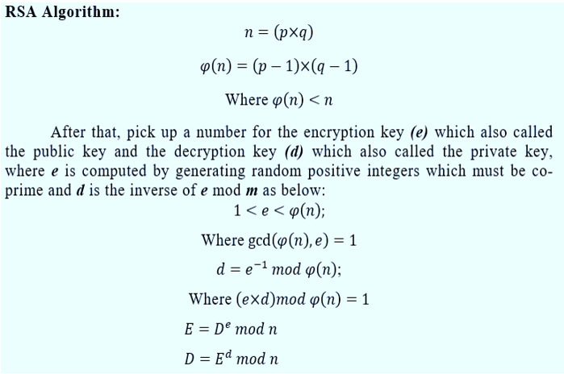

# RSA (Rivest–Shamir–Adleman)

*In this lesson you'll build RSA by hand with small numbers, see why it works,
write a real 2048-bit version in Python, break the naive version three ways, and
find out how real systems fix it. The last part goes to expert level: the
attacks on badly made keys, the history of factoring and what the proofs say.*

**Before this:** [Modular arithmetic](../book/03-The-Arithmetic-of-Secrets.md) (inverses,
fast powers, Euler's theorem). **Levels:** sections 1 to 3 need only school
arithmetic, 4 to 7 the modular arithmetic lesson, and 8 is for experts.

## 1. The problem

In 1976 Whitfield Diffie and Martin Hellman published an idea that sounded
impossible: a lock with two keys. One key, the **public** one, you give to the
world. Anyone can use it to lock a message to you. The other, the **private**
key, never leaves you, and only it can unlock. Run it the other way and you get
a **signature**: lock something with your private key, and anyone can check
with your public key that only you could have done it.

They had no way to build it. They had found how to *agree* on a key in public
([Diffie-Hellman](../01-key-exchange/Diffie-Hellman.md)), but not how to
encrypt or sign with a public key. The missing piece was a **trapdoor**: a
calculation that is easy to do, hard to undo, and easy again if you know a
secret.

At MIT, Ron Rivest and Adi Shamir (computer scientists) and Leonard Adleman (a
number theorist) spent months on it. Rivest and Shamir proposed schemes;
Adleman broke them, one after another, about 40 times. In April 1977, after an
evening at a student's Passover dinner, Rivest wrote down one that Adleman
couldn't break. It used a fact every number theorist knows: **multiplying two
primes is easy, but nobody knows a fast way to split the product back into
them.**

Martin Gardner announced it in his *Scientific American* column that August and
printed a challenge: a message encrypted under a 129-digit key, $100 to whoever
read it. The authors estimated it would take 40 quadrillion years.

## 2. The idea in one picture



- Pick two secret primes $p$ and $q$ and publish their product $n$.
- Encrypting is raising to a power $e$, mod $n$. Decrypting is raising to
  another power $d$, mod $n$, that undoes it.
- Working out $d$ from $e$ needs $(p-1)(q-1)$, which needs $p$ and $q$.
  Without the factors, nobody knows how.

## 3. Build it by hand

Real keys use primes of over 300 digits. With tiny primes every step fits on a
line, and you can check each one with a calculator or Python's `pow`.

**Step 1: two primes.** $p = 61$, $q = 53$.

**Step 2: the modulus.** $n = p \cdot q = 3233$. This is public.

**Step 3: the totient.** $\varphi(n) = (p-1)(q-1) = 60 \times 52 = 3120$. This
is secret: it needs $p$ and $q$.

**Step 4: the public exponent.** Choose $e$ with no factor in common with 3120.
$e = 17$ works. The **public key** is $(n, e) = (3233, 17)$.

**Step 5: the private exponent.** Find $d$ with $e \cdot d \equiv 1 \pmod{3120}$,
the inverse of 17 mod 3120. The extended Euclid algorithm does it:

$$
\begin{aligned}
3120 &= 183 \times 17 + 9 \\
17 &= 1 \times 9 + 8 \\
9 &= 1 \times 8 + 1
\end{aligned}
$$

and working back up, $1 = 2 \cdot 3120 - 367 \cdot 17$. So $-367 \cdot 17 \equiv 1$,
and $d = -367 + 3120 = 2753$. Check: $17 \times 2753 = 46801 = 15 \times 3120 + 1$.
The **private key** is $d = 2753$.

**Step 6: encrypt.** A message is a number below $n$. Take $m = 65$:

$$
c = m^e \bmod n = 65^{17} \bmod 3233 = 2790 .
$$

Press Step to watch the square-and-multiply method do it in five squarings:

<div class="mars-modexp" data-base="65" data-exp="17" data-mod="3233" data-label="Encrypting m = 65: c = 65¹⁷ mod 3233"></div>

**Step 7: decrypt.** $c^d \bmod n = 2790^{2753} \bmod 3233 = 65$. The message
is back.

**Step 8: sign and verify.** Swap the roles. To sign $m = 65$, use the private
exponent: $s = 65^{2753} \bmod 3233 = 588$. Anyone can verify with the public
one: $588^{17} \bmod 3233 = 65$, which matches, so the signature is good.

## 4. Why it works

Decrypting raises to $e$ and then to $d$, so it computes $m^{ed}$. We chose
$e d = 1 + k \, \varphi(n)$ for some whole number $k$ (in the example,
$k = 15$). [Euler's theorem](../book/03-The-Arithmetic-of-Secrets.md#37-fermats-little-theorem-and-eulers-theorem)
says $m^{\varphi(n)} \equiv 1 \pmod n$. So

$$
m^{ed} = m^{1 + k\varphi(n)} = m \cdot \left(m^{\varphi(n)}\right)^k \equiv m \cdot 1^k = m \pmod n .
$$

(Euler's theorem needs $m$ to share no factor with $n$; the Chinese remainder
theorem shows it works for every $m$ below $n$ anyway.)

**Why it's hard to break.** An attacker sees $n$ and $e$. To get $d$ they need
$\varphi(n)$, and knowing $\varphi(n)$ is as good as knowing $p$ and $q$. So
breaking the key means **factoring $n$**. For 3233 that takes a moment. For a
617-digit $n$, the best known method, the general number field sieve, needs
about $2^{112}$ operations. It's not *proven* hard, only unsolved after
centuries of trying (see [Hard problems](../10-math-foundations/Hard-Problems.md)).

## 5. Code it

Now the real size. First we need big random primes: pick random odd numbers and
test them with [Miller-Rabin](../10-math-foundations/Miller-Rabin-Primality-Test.md).
About one odd 1,024-bit number in 355 is prime, so it takes a few hundred tries.

```python
import secrets
from math import gcd

def is_prime(n, rounds=40):              # Miller-Rabin
    if n < 2:
        return False
    for p in (2, 3, 5, 7, 11, 13):
        if n % p == 0:
            return n == p
    d, s = n - 1, 0
    while d % 2 == 0:
        d, s = d // 2, s + 1
    for _ in range(rounds):
        x = pow(secrets.randbelow(n - 3) + 2, d, n)
        if x in (1, n - 1):
            continue
        for _ in range(s - 1):
            x = x * x % n
            if x == n - 1:
                break
        else:
            return False
    return True

def random_prime(bits):
    while True:
        p = secrets.randbits(bits) | 3 << (bits - 2) | 1   # top two bits set, so n has full length; odd
        if is_prime(p):
            return p
```

Then the key, exactly as in steps 1 to 5. Almost everyone uses $e = 65537$
($2^{16} + 1$, a [Fermat prime](../10-math-foundations/Fermat-Primes.md)): it's
prime, and with only two 1 bits it makes encryption and verification fast.

```python
def keygen(bits=2048, e=65537):
    while True:
        p, q = random_prime(bits // 2), random_prime(bits // 2)
        phi = (p - 1) * (q - 1)
        if p != q and gcd(e, phi) == 1:
            return (p * q, e), (p * q, pow(e, -1, phi))

pub, priv = keygen()
n, e = pub
m = int.from_bytes(b"meet me at noon", "big")      # text to a number
c = pow(m, e, n)
print(n.bit_length(), pow(c, priv[1], n).to_bytes(15, "big"))
# 2048 b'meet me at noon'
```

It runs in a couple of seconds. That's a real 2048-bit RSA key. And it is
**not safe to use**, for reasons the next section shows.

## 6. Break it

What you just wrote is **textbook RSA**. It has three problems, and each one has
been used against real systems.

**Attack 1: guess and check.** Textbook RSA is deterministic: the same message
always gives the same ciphertext. If the message is one of a few possibilities,
the attacker encrypts each with your public key and compares:

```python
c_vote = pow(int.from_bytes(b"yes", "big"), e, n)            # a voter sends this
votes = {pow(int.from_bytes(v, "big"), e, n): v for v in (b"yes", b"no")}
print(votes[c_vote])                                          # b'yes': the attacker reads it
```

**Attack 2: small $e$, short message.** Some systems used $e = 3$ to be fast. If
$m^3$ is smaller than $n$, the "mod $n$" never happens, and an ordinary cube root
gives $m$ back. No key needed:

```python
def iroot3(x):                  # integer cube root by binary search
    lo, hi = 0, 1 << (x.bit_length() // 3 + 1)
    while lo < hi:
        mid = (lo + hi) // 2
        if mid ** 3 < x:
            lo = mid + 1
        else:
            hi = mid
    return lo

pub3, _ = keygen(2048, 3)
c3 = pow(int.from_bytes(b"attack at dawn", "big"), 3, pub3[0])
print(iroot3(c3).to_bytes(14, "big"))   # b'attack at dawn'
```

**Attack 3: tampering.** Multiply a ciphertext by $2^e$ and the plaintext
doubles, since $(2^e \cdot m^e) = (2m)^e$. An attacker can change a message
without reading it. Worse, a server that decrypts tampered ciphertexts and says
anything about the result (even "error") can be used to decrypt.

**The fix: padding with randomness.** Before encrypting, real RSA mixes the
message with fresh random bytes in a fixed format. **OAEP** (Bellare and
Rogaway, 1994) does it for encryption, and **PSS** (1996) for signatures. Now
the same message encrypts differently each time, the padded number is always
nearly as big as $n$, and tampering scrambles the padding, which decryption
detects. In practice you never write this yourself:

```python
# pip install cryptography
from cryptography.hazmat.primitives.asymmetric import rsa, padding
from cryptography.hazmat.primitives import hashes

key = rsa.generate_private_key(public_exponent=65537, key_size=3072)
oaep = padding.OAEP(mgf=padding.MGF1(hashes.SHA256()), algorithm=hashes.SHA256(), label=None)
c = key.public_key().encrypt(b"meet me at noon", oaep)
print(key.decrypt(c, oaep))
```

## 7. RSA in the real world

**Where you meet it.** Most certificates that make the padlock in your browser
are still RSA signatures. It signs software updates, PDF documents and many
SSH keys. It used to carry the session key in TLS too, until TLS 1.3 (2018)
dropped that in favor of Diffie-Hellman, which keeps old traffic safe even if
the key leaks later. RSA can only encrypt data smaller than $n$, so it always
wraps a short symmetric key, never the data itself.

**Sizes.** 2048 bits is the minimum (about 112-bit security), 3072 bits for
data that must stay safe past 2030. Elliptic-curve keys give the same strength
far smaller: 256 bits for [Ed25519](EdDSA.md) against 3072 for RSA.

**The secret history.** In 1997 GCHQ revealed that Clifford Cocks, a young
mathematician there, had found the same scheme in 1973, a few weeks after joining.
It was classified and never used. James Ellis had proposed "non-secret
encryption" in 1970.

**The patent.** MIT patented RSA in 1983, and the patent ran until September
2000. That's one reason the free alternatives DSA and ElGamal were written. US
export rules treated strong cryptography as a weapon; in the 1990s browsers sold
abroad could use only 512-bit RSA, and Phil Zimmermann was under criminal
investigation for three years after his PGP program, built on RSA, spread
worldwide.

**What went wrong over the years:**

- **RSA-129 (1994).** Gardner's 129-digit challenge was broken in 17 years, not
  40 quadrillion, by 1,600 volunteers' computers. The message: "The Magic
  Words are Squeamish Ossifrage". Factoring had improved far faster than the
  authors guessed. The record today is RSA-250, 829 bits, factored in 2020.
- **Bleichenbacher (1998).** Daniel Bleichenbacher showed that an SSL server that
  only reveals whether PKCS#1 v1.5 padding was valid can be made to decrypt any
  ciphertext, in about a million queries. Attack 3 above, for real. It came back
  as **ROBOT** in 2017, against servers of Facebook and PayPal, and again as the
  **Marvin** timing attack in 2023.
- **Debian (2008).** A one-line change in Debian's OpenSSL left only 32,768
  possible keys on affected machines, for two years.
- **Mining your Ps and Qs (2012).** Researchers collected millions of public keys
  and found that tens of thousands shared a prime with another key, because
  routers made keys at boot before they had any randomness. One gcd broke both.
- **ROCA (2017).** Infineon's chips built primes with a hidden pattern that made
  them factorable. Estonia had to block the certificates on about 750,000
  national ID cards.
- **FREAK (2015).** Servers that still accepted 1990s "export" 512-bit RSA could
  be tricked into using it, and 512-bit keys could be factored in hours on rented
  cloud machines.

**Its future.** A large quantum computer running [Shor's
algorithm](../book/20-Quantum-Computers.md) would factor $n$ quickly at any size.
NIST IR 8547 deprecates RSA after 2030 and disallows it after 2035; its
replacements are [ML-DSA](ML-DSA.md) for signatures and
[ML-KEM](../01-key-exchange/ML-KEM.md) for key exchange.

## 8. Going deeper

This part is for readers who want the whole picture: how RSA keys are attacked
when they're made carelessly, how the factoring record keeps moving, and what
the security proofs actually say.

### How keys must be made

FIPS 186-5 and the libraries that follow it add rules on top of steps 1 to 5,
and each rule is there because of an attack:

| Rule | The attack it stops |
|---|---|
| $p$ and $q$ random, from a good [random generator](../09-random/OS-RNG.md) | shared or guessable primes (Debian 2008, 2012 survey) |
| top two bits of $p$ and $q$ set | keys shorter than claimed |
| $\lvert p - q \rvert$ large | Fermat's factoring method |
| $d$ large (at least $\sqrt{n}$, in practice about the size of $n$) | Wiener and Boneh-Durfee |
| $e \ge 65537$ and padding always on | Håstad's broadcast attack, cube roots |
| one key for one job | signing oracles turning into decryption |

### Fermat's method: when $p$ and $q$ are close

If $p$ and $q$ are close, $n$ is close to a square: $n = a^2 - b^2 = (a-b)(a+b)$
with $a$ just above $\sqrt n$ and $b$ small. Try $a = \lceil \sqrt n \rceil,
\lceil \sqrt n \rceil + 1, \ldots$ until $a^2 - n$ is a perfect square. Fermat
described it in 1643. In 2022 Hanno Böck ran it on public keys and broke keys
from printers by Canon and Fujifilm, made by a library that picked $q$ as the
next prime after $p$ (CVE-2022-26320).

### Wiener's attack: when $d$ is small

A small $d$ makes decryption fast, which tempted designers of smart cards.
Michael Wiener showed in 1990 that if $d < \frac13 n^{1/4}$, then $k/d$ is one of
the **continued fraction convergents** of $e/n$, because $e d - k\varphi(n) = 1$
and $\varphi(n) \approx n$. Try each convergent, compute the $\varphi$ it implies,
and check whether it gives integer $p$ and $q$:

```python
from math import isqrt

def convergents(a, b):                   # convergents of the continued fraction of a/b
    h0, h1, k0, k1 = 0, 1, 1, 0
    while b:
        x, a, b = a // b, b, a % b
        h0, h1, k0, k1 = h1, x * h1 + h0, k1, x * k1 + k0
        yield h1, k1

def wiener(n, e):
    for k, d in convergents(e, n):
        if k and (e * d - 1) % k == 0:
            phi = (e * d - 1) // k
            s = n - phi + 1              # this is p + q
            r = s * s - 4 * n            # and this is (p - q)^2
            if r >= 0 and isqrt(r) ** 2 == r:
                return d

p, q = 1000000007, 998244353
n, phi = p * q, (p - 1) * (q - 1)
e = pow(101, -1, phi)                    # the owner picked d = 101 to be fast
print(wiener(n, e))                      # 101
```

Boneh and Durfee (1999) pushed the bound to $d < n^{0.292}$ with lattice methods.

### Håstad's broadcast attack: the same message to three people

With $e = 3$ and no padding, send one message $m$ to three people with moduli
$n_1, n_2, n_3$. The attacker has $m^3 \bmod n_i$ for each. The
[Chinese remainder theorem](../book/03-The-Arithmetic-of-Secrets.md#38-the-chinese-remainder-theorem)
joins them into $m^3 \bmod n_1 n_2 n_3$, and since $m < n_i$, $m^3$ is smaller
than the product: the "mod" disappears and a cube root gives $m$. Johan Håstad
published the general form in 1985.

```python
from math import prod

ns = [keygen(1024, 3)[0][0] for _ in range(3)]            # three people, all with e = 3
m = int.from_bytes(b"the same secret for everyone, sent three times", "big")
cs = [pow(m, 3, n) for n in ns]
M = prod(ns)
x = sum(c * (M // n) * pow(M // n, -1, n) for c, n in zip(cs, ns)) % M   # CRT gives m^3 exactly
print(iroot3(x).to_bytes(46, "big"))
```

Randomized padding gives each recipient a different padded number, which ends
it. Coppersmith's method (1996) generalizes all of this: it finds small roots
of polynomials mod $n$, and so breaks RSA whenever an attacker knows enough of
the message, of $p$, or of $d$ (half the bits of $p$ are enough to factor $n$).

### The common modulus mistake

If one $n$ is shared by two users with exponents $e_1, e_2$ (gcd 1), anyone who
sees the same $m$ encrypted to both finds $a, b$ with $a e_1 + b e_2 = 1$ by
extended Euclid and computes $c_1^a c_2^b = m$. Gus Simmons pointed this out in
1983. Worse, either user can factor $n$ from their own $e$ and $d$. Every key
needs its own $n$.

### How factoring got faster

| Method | Year | Cost for an $n$ of $b$ bits | What it changed |
|---|---|---|---|
| Trial division | ancient | about $2^{b/2}$ | nothing past 20 digits |
| Pollard's $p - 1$ | 1974 | fast if $p - 1$ has only small factors | led to the old "strong prime" rules |
| Quadratic sieve | Pomerance, 1981 | $e^{(1 + o(1))\sqrt{\ln n \ln \ln n}}$ | RSA-129 in 1994 |
| Elliptic curve method | Lenstra, 1985 | depends on the size of $p$, not $n$ | finds small factors, not RSA primes |
| Number field sieve | Pollard 1988, then many | $e^{(1.923 + o(1))(\ln n)^{1/3}(\ln \ln n)^{2/3}}$ | every record since 1996 |

The number field sieve's cost grows more slowly than any power of $2^b$ but
faster than any polynomial. That's why key sizes must grow faster than security
levels: 2048 bits for 112-bit security, 3072 for 128, 15,360 for 256.

### What the proofs say

- **The RSA problem** (find $m$ from $m^e \bmod n$) is not known to be as hard as
  factoring. It could be easier; nobody has found a way. The **Rabin
  cryptosystem** (Michael Rabin, 1979) uses $e = 2$ and *is* provably as hard as
  factoring, but decrypting gives four square roots to choose from, and it
  never caught on.
- **RSA-OAEP** is IND-CCA2 in the random oracle model. Bellare and Rogaway's
  1994 proof had a gap that Victor Shoup found in 2001; Fujisaki, Okamoto,
  Pointcheval and Stern repaired it the same year for RSA specifically.
- **RSA-PSS** has a tight proof: forging is about as hard as inverting RSA. The
  older PKCS#1 v1.5 signatures had no proof until 2018 (Jager, Kakvi and May),
  which is part of why PSS is recommended.
- **RSA-KEM** (Shoup, 2001) skips padding entirely: encrypt a random number
  $r < n$ and hash it into a key. It is the simplest provably secure way to use
  RSA for key transport (RFC 5990).

## Try it

??? question "1. With $p = 5$, $q = 11$ and $e = 3$, find $n$, $\varphi(n)$ and $d$, then encrypt $m = 2$ and decrypt."

    $n = 55$, $\varphi(n) = 40$, $d = 27$ (since $3 \times 27 = 81 = 2 \times 40 + 1$).
    $c = 2^3 = 8$, and $8^{27} \bmod 55 = 2$.

??? question "2. Why can't $e$ be 2?"

    $\varphi(n) = (p-1)(q-1)$ is always even, so 2 shares a factor with it and has no
    inverse. There'd be no $d$.

??? question "3. Someone's public key is $(n, e) = (3233, 17)$. Find their private key."

    Factor 3233: try primes up to $\sqrt{3233} \approx 57$, and 53 works, giving $61 \times 53$.
    Then $\varphi = 3120$ and $d = 17^{-1} \bmod 3120 = 2753$. That's the whole attack, and
    it's why $n$ must be hundreds of digits long.

??? question "4. Couldn't an attacker just store every 1,024-bit prime and look up the factors?"

    There are about $10^{305}$ of them. Storing them would take around $10^{307}$ bytes,
    far more than there are atoms in the universe (about $10^{80}$). See the
    [FAQ](../FAQ.md#can-an-attacker-just-pre-calculate-everything-and-look-up-the-answer).

??? question "5. Two RSA keys have moduli $n_1$ and $n_2$ built with a shared prime. How do you factor both?"

    $p = \gcd(n_1, n_2)$, then $q_1 = n_1 / p$ and $q_2 = n_2 / p$. Euclid's algorithm does it
    in milliseconds, which is exactly the 2012 attack.

## What you learned

- RSA's trapdoor is factoring: $n = pq$ is public, $\varphi(n)$ and so $d$ need
  $p$ and $q$.
- Encrypt with $m^e$, decrypt with $c^d$, sign with $m^d$, verify with $s^e$,
  all mod $n$; Euler's theorem makes them undo each other.
- Textbook RSA is deterministic and malleable. Real RSA always uses OAEP or PSS,
  through a tested library.
- Most real failures came from bad randomness, padding oracles and old key
  sizes, not from factoring.

**Next:** [DSA](DSA.md), the US government's answer to RSA's patent, built on
discrete logarithms instead of factoring.

## Reference

??? abstract "Faster decryption with the Chinese remainder theorem"

    Libraries keep $p$ and $q$ and work mod each separately (RFC 8017 §5.1.2):

    $$
    \begin{aligned}
    d_P &= d \bmod (p-1) = 53, \qquad d_Q = d \bmod (q-1) = 49, \qquad q_{\mathrm{Inv}} = q^{-1} \bmod p = 38 \\
    m_1 &= c^{d_P} \bmod p = 2790^{53} \bmod 61 = 4 \\
    m_2 &= c^{d_Q} \bmod q = 2790^{49} \bmod 53 = 12 \\
    h &= q_{\mathrm{Inv}} \cdot (m_1 - m_2) \bmod p = 38 \times (4 - 12) \bmod 61 = 1 \\
    m &= m_2 + h \cdot q = 12 + 1 \times 53 = 65
    \end{aligned}
    $$

    Two half-size exponentiations cost about a quarter of one full-size one. The catch: if a fault corrupts
    one half, the faulty signature reveals a prime factor (the Boneh–DeMillo–Lipton attack, 1997), so
    libraries check every signature before releasing it. See [Side channels](../book/18-Side-Channels.md).

??? info "Standards, sizes and status"

    | | |
    |---|---|
    | Standard | RFC 8017 (PKCS #1 v2.2); FIPS 186-5 for signatures |
    | Encryption padding | OAEP (use it); PKCS#1 v1.5 (legacy, padding-oracle prone) |
    | Signature padding | PSS (recommended); PKCS#1 v1.5 (still common, acceptable) |
    | Key sizes | 2048 bits minimum (112-bit security), 3072 (128), 4096 (about 140) |
    | Status | in the [main table](../index.md#2-digital-signatures); NIST IR 8547: deprecated after 2030, disallowed after 2035 |

**See also:** [ECDSA](ECDSA.md) and [Ed25519](EdDSA.md) (smaller signatures),
[Blind signatures](Blind-Signatures.md) (RSA signing without seeing the message),
[ElGamal](../03-public-key-encryption/ElGamal.md) and
[HPKE](../03-public-key-encryption/HPKE.md) (other ways to encrypt to a public key),
[FAQ](../FAQ.md).

**References:** RFC 8017; Rivest, Shamir and Adleman, "A Method for Obtaining
Digital Signatures and Public-Key Cryptosystems", *Communications of the ACM*,
1978; Bleichenbacher, CRYPTO '98.
