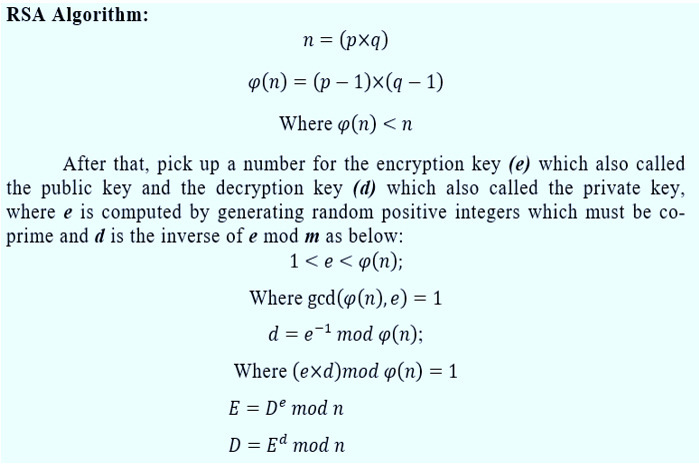

# 13. RSA

*Diffie and Hellman showed how to agree on a key in public, but not how to
encrypt to someone or sign a message with a public key. RSA, in 1977, did both.
In this chapter you build RSA by hand with small numbers, see why it works,
write a real 2048-bit version, and break the naive "textbook" version several
ways. Then you add what real RSA needs: OAEP padding for encryption, PSS
padding for signatures, and the Chinese remainder theorem for speed, along with
the attacks that each of those had to survive.*

!!! abstract "In this chapter"
    **You will learn:**

    - what a trapdoor one-way function is, and why factoring gives one
    - how to make an RSA key, encrypt, decrypt, sign and verify, by hand and in Python
    - why textbook RSA is insecure, and how OAEP and PSS padding fix it
    - how the Chinese remainder theorem makes RSA four times faster, and how a single fault breaks it
    - the attacks on badly made keys: shared primes, close primes, small $d$, small $e$
    - where RSA is used today, which sizes to pick, and why it is being retired

    **You need:** [Chapter 3](03-The-Arithmetic-of-Secrets.md) (inverses, fast powers, Euler's theorem,
    the Chinese remainder theorem) and [Chapter 12](12-Diffie-Hellman.md) (the public-key idea).
    [Chapter 9](09-Hash-Functions.md) for the hashes inside OAEP and PSS.

    **Levels:** 13.1 to 13.4 need only school arithmetic plus Chapter 3; 13.5 to 13.10 are intermediate;
    13.12 is for experts.

## 13.1 The problem

Diffie and Hellman's 1976 paper described an idea that sounded impossible: a
lock with two keys. One key, the **public** one, you give to the world. Anyone
can use it to lock a message to you. The other, the **private** key, never
leaves you, and only it can unlock. Run it the other way and you get a
**signature**: lock something with your private key, and anyone can check with
your public key that only you could have done it.

They had no way to build it. Their key exchange ([Chapter 12](12-Diffie-Hellman.md))
lets two people who are both online agree on a key, but it does not let you
encrypt a message to someone who is asleep, or sign a document. The missing
piece was a **trapdoor one-way function**: a calculation that is easy to do,
hard to undo, and easy again if you know a secret.

At MIT, Ron Rivest and Adi Shamir (computer scientists) and Leonard Adleman (a
number theorist) spent months on it. Rivest and Shamir proposed schemes;
Adleman broke them, one after another. In April 1977, after an evening at a
student's Passover dinner, Rivest could not sleep, and by morning he had
written down one that Adleman could not break. It used a fact every number
theorist knows: **multiplying two primes is easy, but nobody knows a fast way to
split the product back into them.**

Martin Gardner announced it in his "Mathematical Games" column in *Scientific
American* that August. The column printed a challenge: a message encrypted
under a 129-digit modulus, with \$100 to whoever read it, and quoted an estimate
that factoring such a number would take 40 quadrillion years. The formal paper,
"A Method for Obtaining Digital Signatures and Public-Key Cryptosystems",
appeared in *Communications of the ACM* in February 1978, with "Alice" and
"Bob" as its sender and receiver.

## 13.2 The idea in one picture



- Pick two secret primes $p$ and $q$ and publish their product $n$.
- Encrypting is raising to a power $e$, mod $n$. Decrypting is raising to
  another power $d$, mod $n$, that undoes it.
- Working out $d$ from $e$ needs $(p-1)(q-1)$, which needs $p$ and $q$.
  Without the factors, nobody knows how.

Compare Diffie-Hellman. There, the one-way function was $x \mapsto g^x \bmod p$
and nobody, not even its owner, can run it backwards. RSA's function
$m \mapsto m^e \bmod n$ has a **trapdoor**: the owner, who knows the factors,
can run it backwards with $d$.

## 13.3 Build it by hand

Real keys use primes of over 300 digits. With tiny primes every step fits on a
line, and you can check each one with a calculator or Python's `pow`.

**Step 1: two primes.** $p = 61$, $q = 53$.

**Step 2: the modulus.** $n = p \cdot q = 3233$. This is public.

**Step 3: the totient.** $\varphi(n) = (p-1)(q-1) = 60 \times 52 = 3120$. This
is secret: it needs $p$ and $q$.

**Step 4: the public exponent.** Choose $e$ with no factor in common with 3120.
$e = 17$ works. The **public key** is $(n, e) = (3233, 17)$.

**Step 5: the private exponent.** Find $d$ with $e \cdot d \equiv 1 \pmod{3120}$,
the inverse of 17 mod 3120. The extended Euclid algorithm does it:

$$
\begin{aligned}
3120 &= 183 \times 17 + 9 \\
17 &= 1 \times 9 + 8 \\
9 &= 1 \times 8 + 1
\end{aligned}
$$

and working back up, $1 = 2 \cdot 3120 - 367 \cdot 17$. So $-367 \cdot 17 \equiv 1$,
and $d = -367 + 3120 = 2753$. Check: $17 \times 2753 = 46801 = 15 \times 3120 + 1$.
The **private key** is $d = 2753$.

**Step 6: encrypt.** A message is a number below $n$. Take $m = 65$:

$$
c = m^e \bmod n = 65^{17} \bmod 3233 = 2790 .
$$

Press Step to watch the square-and-multiply method do it in five squarings:

<div class="mars-modexp" data-base="65" data-exp="17" data-mod="3233" data-label="Encrypting m = 65: c = 65¹⁷ mod 3233"></div>

**Step 7: decrypt.** $c^d \bmod n = 2790^{2753} \bmod 3233 = 65$. The message
is back.

**Step 8: sign and verify.** Swap the roles. To sign $m = 65$, use the private
exponent: $s = 65^{2753} \bmod 3233 = 588$. Anyone can verify with the public
one: $588^{17} \bmod 3233 = 65$, which matches, so the signature is good.

## 13.4 Why it works, and why it is hard to break

Decrypting raises to $e$ and then to $d$, so it computes $m^{ed}$. We chose
$e d = 1 + k \, \varphi(n)$ for some whole number $k$ (in the example,
$k = 15$). Euler's theorem ([Chapter 3](03-The-Arithmetic-of-Secrets.md)) says
$m^{\varphi(n)} \equiv 1 \pmod n$ when $\gcd(m, n) = 1$. So

$$
m^{ed} = m^{1 + k\varphi(n)} = m \cdot \left(m^{\varphi(n)}\right)^k \equiv m \cdot 1^k = m \pmod n .
$$

What if $m$ happens to share a factor with $n$, say $p \mid m$? Then work mod
each prime separately. Mod $p$, both sides are 0. Mod $q$, Fermat's little
theorem gives $m^{ed} \equiv m$ as before. Since $m^{ed} \equiv m$ both mod $p$
and mod $q$, the Chinese remainder theorem says $m^{ed} \equiv m \pmod{n}$. So
RSA works for every $m$ below $n$. (Such an $m$ would reveal a factor of $n$
through $\gcd(m, n)$, but for random 1024-bit primes the chance of hitting one is
about $2^{-1023}$.)

**Why it's hard to break.** An attacker sees $n$ and $e$. To get $d$ they need
$\varphi(n)$, and knowing $\varphi(n)$ is as good as knowing $p$ and $q$:
$p + q = n - \varphi(n) + 1$, and two numbers with known sum and product are
the roots of a quadratic. Even knowing $d$ alone lets you factor $n$ (a
randomized algorithm does it quickly). So recovering the private key is exactly
as hard as **factoring $n$**. For 3233 that takes a moment. For a 617-digit $n$,
the best known method, the general number field sieve, needs about $2^{112}$
operations.

Two things are *not* proved. Factoring is not proved hard; it is only unsolved
after centuries of effort. And decrypting one message, the **RSA problem** (find
$m$ from $m^e \bmod n$), is not proved to need factoring; nobody knows a way
that doesn't. See [Hard problems](../10-math-foundations/Hard-Problems.md).

## 13.5 Code it

*Level: intermediate.* Now the real size. First we need big random primes: pick
random odd numbers and test them with the Miller-Rabin test ([Chapter
3](03-The-Arithmetic-of-Secrets.md); details in the [Miller-Rabin
reference](../10-math-foundations/Miller-Rabin-Primality-Test.md)). By the prime
number theorem, about one odd 1,024-bit number in 355 is prime, so it takes a
few hundred tries.

```python
import secrets
from math import gcd

def is_prime(n, rounds=40):              # Miller-Rabin
    if n < 2:
        return False
    for p in (2, 3, 5, 7, 11, 13):
        if n % p == 0:
            return n == p
    d, s = n - 1, 0
    while d % 2 == 0:
        d, s = d // 2, s + 1
    for _ in range(rounds):
        x = pow(secrets.randbelow(n - 3) + 2, d, n)
        if x in (1, n - 1):
            continue
        for _ in range(s - 1):
            x = x * x % n
            if x == n - 1:
                break
        else:
            return False
    return True

def random_prime(bits):
    while True:
        p = secrets.randbits(bits) | 3 << (bits - 2) | 1   # top two bits set, so n has full length; odd
        if is_prime(p):
            return p
```

Then the key, exactly as in steps 1 to 5. Almost everyone uses $e = 65537$
($2^{16} + 1$, a [Fermat prime](../10-math-foundations/Fermat-Primes.md)): it's
prime, and with only two 1 bits it makes encryption and verification fast.

```python
def keygen(bits=2048, e=65537):
    while True:
        p, q = random_prime(bits // 2), random_prime(bits // 2)
        phi = (p - 1) * (q - 1)
        if p != q and gcd(e, phi) == 1:
            return (p * q, e), (p * q, pow(e, -1, phi))

pub, priv = keygen()
n, e = pub
m = int.from_bytes(b"meet me at noon", "big")      # text to a number
c = pow(m, e, n)
print(n.bit_length(), pow(c, priv[1], n).to_bytes(15, "big"))
# 2048 b'meet me at noon'
```

It runs in a couple of seconds. That's a real 2048-bit RSA key. And it is
**not safe to use**, for reasons the next section shows. The code blocks in
§13.6 to §13.8 continue from this one and use its `keygen`, `n`, `e` and `priv`.

## 13.6 Break textbook RSA

*Level: intermediate.* What you just wrote is **textbook RSA**: the bare
formula $c = m^e \bmod n$. It has three problems, and each one has been used
against real systems.

**Attack 1: guess and check.** Textbook RSA is deterministic: the same message
always gives the same ciphertext. If the message is one of a few possibilities,
the attacker encrypts each with your public key and compares:

```python
c_vote = pow(int.from_bytes(b"yes", "big"), e, n)            # a voter sends this
votes = {pow(int.from_bytes(v, "big"), e, n): v for v in (b"yes", b"no")}
print(votes[c_vote])                                          # b'yes': the attacker reads it
```

Encryption with a public key can never hide a message from someone who can
guess it, unless every encryption uses fresh randomness. This is the lesson of
semantic security ([Chapter 17](17-Defining-Security.md)).

**Attack 2: small $e$, short message.** Some systems used $e = 3$ to be fast. If
$m^3$ is smaller than $n$, the "mod $n$" never happens, and an ordinary cube root
gives $m$ back. No key needed:

```python
def iroot3(x):                  # integer cube root by binary search
    lo, hi = 0, 1 << (x.bit_length() // 3 + 1)
    while lo < hi:
        mid = (lo + hi) // 2
        if mid ** 3 < x:
            lo = mid + 1
        else:
            hi = mid
    return lo

pub3, _ = keygen(2048, 3)
c3 = pow(int.from_bytes(b"attack at dawn", "big"), 3, pub3[0])
print(iroot3(c3).to_bytes(14, "big"))   # b'attack at dawn'
```

**Attack 3: tampering (malleability).** RSA is multiplicative:
$(m_1 m_2)^e = m_1^e \, m_2^e$. Multiply a ciphertext by $2^e$ and the plaintext
doubles, since $2^e \cdot m^e = (2m)^e$. An attacker can change a message
without reading it. Worse, a server that decrypts tampered ciphertexts and says
anything at all about the result (even "error") can be used to decrypt, as
§13.7 shows.

The fix for all three is the same: **never encrypt the message directly**. Mix it
with fresh random bytes in a fixed, checkable format first. That is padding.

## 13.7 Encryption padding: from PKCS #1 v1.5 to OAEP

*Level: intermediate.*

### PKCS #1 v1.5 and Bleichenbacher's attack

RSA Laboratories published the first padding standard, PKCS #1, in the early
1990s. Its encryption format (now called v1.5) builds a block as long as $n$:

$$
\mathtt{00} \,\Vert\, \mathtt{02} \,\Vert\, \text{at least 8 random nonzero bytes} \,\Vert\, \mathtt{00} \,\Vert\, M
$$

The random bytes stop the guess-and-check attack, and the full-length block stops
the cube root. SSL used it to send the session key from browser to server.

In 1998 Daniel Bleichenbacher, then at Bell Labs, showed that it was still
malleable in a deadly way. A server that tells the client whether a decrypted
block started with `00 02` (by an error message, or just by timing) is a
**padding oracle**. The attacker takes the target ciphertext $c$, multiplies it
by $s^e$ for chosen numbers $s$, and sends each result. Every "padding OK" answer
tells them that $s \cdot m \bmod n$ lies in a narrow range, between
$2 \cdot 2^{8(k-2)}$ and $3 \cdot 2^{8(k-2)}$ for a $k$-byte modulus. Each answer
narrows down $m$, and after about a million queries (the "million message
attack") only one value is left. The attacker never touches the private key; the
server decrypts for them, one bit of information at a time.

Patching it meant making every error path look identical, which turned out to
be very hard. It came back in 2017 as **ROBOT** (Hanno Böck, Juraj Somorovsky and
Craig Young), against servers from many vendors and sites including Facebook and
PayPal, and again in 2023 as the **Marvin** attack (Hubert Kario), which used
tiny timing differences. TLS 1.3 removed RSA encryption altogether.

### OAEP

Mihir Bellare and Phillip Rogaway designed **OAEP** (Optimal Asymmetric
Encryption Padding) in 1994. It became PKCS #1 v2.0 in 1998, and today's version
is in RFC 8017. It runs the message through a two-round Feistel network
([Chapter 6](06-Block-Ciphers.md)) built from a hash function, so that every
bit of the padded block depends on every bit of the message and of a random
seed. With hash $H$ (output $h$ bytes) and a **mask generation function** MGF that
stretches a hash to any length:

$$
\begin{aligned}
DB &= H(L) \,\Vert\, \mathtt{00} \ldots \mathtt{00} \,\Vert\, \mathtt{01} \,\Vert\, M \\
\mathit{maskedDB} &= DB \oplus \mathrm{MGF}(\mathit{seed}) \\
\mathit{maskedSeed} &= \mathit{seed} \oplus \mathrm{MGF}(\mathit{maskedDB}) \\
EM &= \mathtt{00} \,\Vert\, \mathit{maskedSeed} \,\Vert\, \mathit{maskedDB}
\end{aligned}
$$

$L$ is an optional label, usually empty. The receiver decrypts, undoes the two
masks in reverse order, and checks that the first byte is 0, that $DB$ starts
with $H(L)$ and that the zeros end in a `01`. A tampered ciphertext decrypts to a
block whose seed and $DB$ are scrambled, and the checks fail with overwhelming
probability.

Here it is with SHA-256 and MGF1, continuing the code of §13.5:

```python
import hashlib

H = lambda b: hashlib.sha256(b).digest()
xor = lambda a, b: bytes(x ^ y for x, y in zip(a, b))

def mgf1(seed, length):                    # mask generation function, RFC 8017 appendix B.2.1
    out = b""
    for i in range((length + 31) // 32):
        out += H(seed + i.to_bytes(4, "big"))
    return out[:length]

def oaep_pad(m, k):                        # k = length of n in bytes
    db = H(b"") + bytes(k - len(m) - 66) + b"\x01" + m
    seed = secrets.token_bytes(32)
    masked_db = xor(db, mgf1(seed, k - 33))
    return b"\x00" + xor(seed, mgf1(masked_db, 32)) + masked_db

def oaep_unpad(em, k):
    masked_seed, masked_db = em[1:33], em[33:]
    db = xor(masked_db, mgf1(xor(masked_seed, mgf1(masked_db, 32)), k - 33))
    rest = db[32:].lstrip(b"\x00")
    if em[0] != 0 or db[:32] != H(b"") or rest[:1] != b"\x01":
        return None                        # real code must not say which check failed
    return rest[1:]

k = (n.bit_length() + 7) // 8
em = oaep_pad(b"meet me at noon", k)
c1 = pow(int.from_bytes(em, "big"), e, n)
c2 = pow(int.from_bytes(oaep_pad(b"meet me at noon", k), "big"), e, n)
print(c1 == c2)                            # False: same message, different ciphertexts
back = pow(c1, priv[1], n).to_bytes(k, "big")
print(oaep_unpad(back, k))                 # b'meet me at noon'
print(oaep_unpad(pow(c1 * pow(2, e, n) % n, priv[1], n).to_bytes(k, "big"), k))   # None
```

The last line is attack 3 again: the doubled ciphertext is now rejected. These
functions interoperate with the PyCA `cryptography` library's
`OAEP(MGF1(SHA256), SHA256)`: each decrypts what the other encrypts. With a
2048-bit key and SHA-256, a message can be at most $256 - 66 = 190$ bytes, which is
plenty for a symmetric key.

OAEP is not immune to oracles either. James Manger showed in 2001 that an
implementation which reveals whether the first byte was zero, separately from
the other checks, can be attacked much like Bleichenbacher's. The comment in
`oaep_unpad` is the rule: one error, same time, whatever went wrong.

## 13.8 Signatures

*Level: intermediate.* Signing with RSA is "decrypting" with the private key:
$s = m^d \bmod n$, checked by $s^e \equiv m$. Textbook signatures are broken
too, and for the same reason, multiplicativity:

```python
N, E, D = 3233, 17, 2753                 # the toy key from 13.3
s1, s2 = pow(5, D, N), pow(7, D, N)      # the owner signs 5 and 7
s = s1 * s2 % N                          # the forger multiplies the signatures
print(pow(s, E, N))                      # 35: a valid signature on 5 * 7, never signed
s = 1234                                 # or picks any s at all
print(pow(s, E, N))                      # s is a valid signature on this "message"
```

Output:

```
35
2183
```

The second forgery is called **existential**: the forger cannot choose the
message (2183 is meaningless), but a signature scheme should not allow even that.

**Hash, then sign.** Every real scheme signs a hash of the message, padded to
the full size of $n$. The hash lets you sign a message of any length, and it
destroys the algebra: the forger would need messages whose hashes multiply
correctly, or a message whose hash is a given number, which a good hash
([Chapter 9](09-Hash-Functions.md)) makes infeasible.

**PKCS #1 v1.5 signatures** pad deterministically:

$$
\mathtt{00} \,\Vert\, \mathtt{01} \,\Vert\, \mathtt{FF} \ldots \mathtt{FF} \,\Vert\, \mathtt{00} \,\Vert\, \text{DigestInfo}(\text{hash name}, H(M))
$$

This format is still everywhere, including most certificates, and it is
considered acceptable. Its danger is in sloppy verifiers. At the CRYPTO 2006 rump
session Bleichenbacher showed that with $e = 3$, a verifier that checked the
prefix and the hash but not that the hash ended exactly at the end of the block
could be fooled: the forger puts garbage after the hash and picks a number whose
cube starts with the right bytes, no private key needed. The same mistake turned
up again in 2014 as **BERserk** in Mozilla's NSS library. The safe way to verify
is to build the expected block yourself and compare all of it.

**PSS** (Probabilistic Signature Scheme, Bellare and Rogaway, 1996) is the
randomized design with a tight security proof, standardized in PKCS #1 v2.1 and
RFC 8017. The signer hashes the message with a random salt, then masks the salt
with MGF1, in the same spirit as OAEP:

$$
\begin{aligned}
h &= H(\mathtt{00}^8 \,\Vert\, H(M) \,\Vert\, \mathit{salt}) \\
EM &= \big( (\mathtt{00} \ldots \mathtt{00} \,\Vert\, \mathtt{01} \,\Vert\, \mathit{salt}) \oplus \mathrm{MGF}(h) \big) \,\Vert\, h \,\Vert\, \mathtt{BC}
\end{aligned}
$$

and the signature is $EM^d \bmod n$. Continuing the code of §13.7, with the
2048-bit key:

```python
def pss_encode(msg, embits):               # EMSA-PSS, SHA-256, 32-byte salt (RFC 8017 9.1.1)
    emlen = (embits + 7) // 8
    salt = secrets.token_bytes(32)
    h = H(bytes(8) + H(msg) + salt)
    db = bytes(emlen - 66) + b"\x01" + salt
    masked = bytearray(xor(db, mgf1(h, emlen - 33)))
    masked[0] &= 0xFF >> (8 * emlen - embits)       # clear the bits above embits
    return bytes(masked) + h + b"\xbc"

def pss_check(msg, em, embits):
    emlen = (embits + 7) // 8
    masked, h = em[:emlen - 33], em[emlen - 33:-1]
    if em[-1] != 0xBC or masked[0] >> (8 - (8 * emlen - embits)):
        return False
    db = bytearray(xor(masked, mgf1(h, emlen - 33)))
    db[0] &= 0xFF >> (8 * emlen - embits)
    if db[:emlen - 66] != bytes(emlen - 66) or db[emlen - 66] != 1:
        return False
    return H(bytes(8) + H(msg) + bytes(db[-32:])) == h

def sign(msg):
    embits = n.bit_length() - 1
    return pow(int.from_bytes(pss_encode(msg, embits), "big"), priv[1], n)

def verify(msg, s):
    embits = n.bit_length() - 1
    em = pow(s, e, n).to_bytes((embits + 7) // 8, "big")
    return pss_check(msg, em, embits)

s = sign(b"pay Bob $10")
print(verify(b"pay Bob $10", s), verify(b"pay Bob $1000", s))   # True False
```

The PyCA library verifies these signatures as
`PSS(MGF1(SHA256), salt_length=32)`, and these functions verify the library's.

A signature proves that the holder of the private key signed *these bytes*. It
does not prove who the holder is; that is the job of certificates in
[Chapter 16](16-PKI-and-Key-Establishment.md).

## 13.9 Speed: the Chinese remainder theorem, and its danger

*Level: intermediate.* Decrypting and signing raise a 2048-bit number to a
2048-bit power. The owner knows $p$ and $q$, and can work mod each half-size prime
separately, then join the results with the Chinese remainder theorem. RFC 8017
(§5.1.2) keeps five numbers in the private key for this:

$$
d_P = d \bmod (p-1), \qquad d_Q = d \bmod (q-1), \qquad q_{\mathrm{Inv}} = q^{-1} \bmod p .
$$

By Fermat, $c^d \equiv c^{d_P} \pmod p$, so the exponents shrink too. With the toy
key and $c = 2790$:

$$
\begin{aligned}
d_P &= 2753 \bmod 60 = 53, \qquad d_Q = 2753 \bmod 52 = 49, \qquad q_{\mathrm{Inv}} = 53^{-1} \bmod 61 = 38 \\
m_1 &= c^{d_P} \bmod p = 2790^{53} \bmod 61 = 4 \\
m_2 &= c^{d_Q} \bmod q = 2790^{49} \bmod 53 = 12 \\
h &= q_{\mathrm{Inv}} \cdot (m_1 - m_2) \bmod p = 38 \times (4 - 12) \bmod 61 = 1 \\
m &= m_2 + h \cdot q = 12 + 1 \times 53 = 65
\end{aligned}
$$

Modular exponentiation costs roughly the cube of the number's length, so each
half-size power costs about an eighth of the full one, and two of them about a
quarter. In practice the gain is three to four times.

**The danger.** In 1996 Dan Boneh, Richard DeMillo and Richard Lipton at Bellcore
noticed that if a fault (a power glitch, a cosmic ray, a buggy CPU) corrupts one
of the two halves, the wrong signature $s'$ is still correct mod $q$ but wrong mod
$p$. Then $s'^e - m$ is a multiple of $q$ but not of $p$, and one gcd factors the
key. Arjen Lenstra pointed out that a single faulty signature and its message are
enough:

```python
import time
from math import gcd

p, q = random_prime(1024), random_prime(1024)
n, e = p * q, 65537
d = pow(e, -1, (p - 1) * (q - 1))
dp, dq, qinv = d % (p - 1), d % (q - 1), pow(q, -1, p)

def power_crt(c, fault=False):             # c^d mod n, the RFC 8017 way
    m1, m2 = pow(c, dp, p), pow(c, dq, q)
    if fault:
        m1 ^= 1                            # a glitch flips one bit of the mod-p half
    h = qinv * (m1 - m2) % p
    return m2 + h * q

c = secrets.randbelow(n)
t0 = time.perf_counter()
for _ in range(20): a = pow(c, d, n)
t1 = time.perf_counter()
for _ in range(20): b = power_crt(c)
t2 = time.perf_counter()
print(a == b, round((t1 - t0) / (t2 - t1), 1))   # True, and a speedup of about 3 to 4

m = int.from_bytes(H(b"firmware v2"), "big")      # sign a hash (no padding, to keep it short)
bad = power_crt(m, fault=True)                    # one faulty signature
print(gcd(pow(bad, e, n) - m, n) == q)            # True: the faulty signature factors n
```

This is not just a laboratory trick. In 2015 Florian Weimer of Red Hat scanned
TLS servers and found some that sent faulty RSA-CRT signatures, leaking their
private keys. The fix is cheap: **verify every signature before releasing it**
(one public-exponent power, which is fast). OpenSSL and other libraries do this.
[Chapter 18](18-Side-Channels.md) covers fault and timing attacks in general.

## 13.10 Use a library

You should understand OAEP and PSS, and you should never ship your own. Real
implementations must be constant time, must hide which padding check failed, and
must check their own signatures. With PyCA `cryptography` (needs
`pip install cryptography`):

```python
# pip install cryptography
from cryptography.hazmat.primitives.asymmetric import rsa, padding
from cryptography.hazmat.primitives import hashes

key = rsa.generate_private_key(public_exponent=65537, key_size=3072)
oaep = padding.OAEP(mgf=padding.MGF1(hashes.SHA256()), algorithm=hashes.SHA256(), label=None)
c = key.public_key().encrypt(b"meet me at noon", oaep)
print(len(c), key.decrypt(c, oaep))              # 384 b'meet me at noon'

pss = padding.PSS(mgf=padding.MGF1(hashes.SHA256()), salt_length=padding.PSS.DIGEST_LENGTH)
sig = key.sign(b"release 1.2", pss, hashes.SHA256())
key.public_key().verify(sig, b"release 1.2", pss, hashes.SHA256())   # raises InvalidSignature if bad
print(len(sig))                                  # 384
```

A 3072-bit key makes 384-byte ciphertexts and signatures. RSA only ever encrypts
something short, a symmetric key; for encrypting to a public key in a new design,
use HPKE ([Chapter 16](16-PKI-and-Key-Establishment.md)), which can use RSA only
through a KEM and is usually built on elliptic curves.

## 13.11 RSA in the real world

**Where you meet it.** Most certificates that make the padlock in your browser
are still RSA signatures. It signs software updates, PDF documents, DNSSEC zones
and many SSH keys. It used to carry the session key in TLS too, until TLS 1.3
(2018) dropped that in favor of Diffie-Hellman, which gives forward secrecy
([Chapter 12](12-Diffie-Hellman.md)).

**Sizes.**

| Modulus | Security (bits) | Status |
|---|---|---|
| 512 | about 50 | broken; factored on rented cloud machines in hours (2015) |
| 1024 | about 80 | retired; assume a well-funded attacker can factor it |
| 2048 | 112 | the minimum today |
| 3072 | 128 | for data that must stay safe past 2030 |
| 15360 | 256 | rarely used; elliptic curves or lattices are far smaller |

Elliptic-curve keys give the same strength far smaller: 256 bits for
[Ed25519](15-Elliptic-Curves.md) against 3072 for RSA. Appendix tables:
[RSA reference](../02-signatures/RSA.md).

**The secret history.** In December 1997 GCHQ revealed that Clifford Cocks, a
young mathematician there, had described the same scheme in a note of November
1973, a few weeks after joining. It was classified and never used. James Ellis
had shown that "non-secret encryption" was possible in 1970.

**The patent and the crypto wars.** MIT patented RSA in 1983, and the patent
ran until September 2000; the inventors' company, RSA Data Security, licensed it
to most security products of the era. That is one reason the free alternatives
DSA and ElGamal were written ([Chapter 14](14-Discrete-Log-Systems.md)). US
export rules treated strong cryptography as a munition, and in the 1990s browsers
sold abroad were limited to 512-bit RSA key exchange. Phil Zimmermann was under
criminal investigation for three years after his PGP program, built on RSA,
spread worldwide in 1991; the case was dropped in 1996.

**What went wrong over the years:**

- **RSA-129 (1994).** Gardner's 129-digit challenge fell in 17 years, not 40
  quadrillion, to about 600 volunteers and 1,600 computers coordinated by Derek
  Atkins, Michael Graff, Arjen Lenstra and Paul Leyland, using the quadratic
  sieve, a method that did not exist in 1977. The message: "The Magic Words are
  Squeamish Ossifrage". The academic record by the number field sieve is
  RSA-250 (829 bits, February 2020, about 2,700 core-years).
- **Bleichenbacher (1998), ROBOT (2017), Marvin (2023).** Padding oracles,
  §13.7.
- **Debian (2008).** A one-line change in Debian's OpenSSL left only 32,768
  possible keys per key type and size on affected machines, for two years.
- **Mining your Ps and Qs (2012).** Nadia Heninger, Zakir Durumeric, Eric
  Wustrow and Alex Halderman collected millions of public keys from the internet
  and found that tens of thousands shared a prime with another key, mostly from
  routers and firewalls that made keys at first boot before they had gathered
  any randomness. One gcd breaks both keys. Arjen Lenstra's team found the same
  that year in "Ron was wrong, Whit is right".
- **FREAK (2015).** Servers that still accepted 1990s "export" 512-bit RSA
  could be tricked into using it, and 512-bit keys could be factored in hours.
- **ROCA (2017).** Infineon's chips built primes with a hidden structure that
  made them factorable. Estonia had to suspend the certificates on about 750,000
  national ID cards.
- **Close primes (2022).** Hanno Böck found printer keys from Canon and Fujifilm
  made by a library that picked $q$ as the next prime after $p$, which Fermat's
  method (§13.12) factors at once (CVE-2022-26320).

The pattern: RSA itself held; key generation, padding and implementations failed.

**Its future.** A large quantum computer running Shor's algorithm
([Chapter 20](20-Quantum-Computers.md)) would factor $n$ quickly at any size.
NIST IR 8547 deprecates RSA after 2030 and disallows it after 2035. Its
replacements are ML-DSA for signatures and ML-KEM for key establishment
([Chapter 21](21-Lattice-Cryptography.md)).

## 13.12 Going deeper

*Level: expert.* How RSA keys are attacked when they are made carelessly, how
the factoring record keeps moving, and what the security proofs actually say.

### How keys must be made

FIPS 186-5 and the libraries that follow it add rules on top of steps 1 to 5,
and each rule is there because of an attack:

| Rule | The attack it stops |
|---|---|
| $p$ and $q$ random, from a good [random generator](../09-random/OS-RNG.md) | shared or guessable primes (Debian 2008, 2012 survey) |
| top two bits of $p$ and $q$ set | keys shorter than claimed |
| $\lvert p - q \rvert$ large | Fermat's factoring method |
| $d$ large (at least $\sqrt{n}$, in practice about the size of $n$) | Wiener and Boneh-Durfee |
| $e \ge 65537$ and padding always on | Håstad's broadcast attack, cube roots |
| one key for one job | signing oracles turning into decryption |

### Fermat's method: when $p$ and $q$ are close

If $p$ and $q$ are close, $n$ is close to a square: $n = a^2 - b^2 = (a-b)(a+b)$
with $a$ just above $\sqrt n$ and $b$ small. Try $a = \lceil \sqrt n \rceil,
\lceil \sqrt n \rceil + 1, \ldots$ until $a^2 - n$ is a perfect square. Fermat
described it in a letter of 1643. Continuing the code of §13.5:

```python
from math import isqrt

def fermat(n):                           # n = a^2 - b^2 = (a - b)(a + b)
    a = isqrt(n - 1) + 1
    while True:
        b2 = a * a - n
        b = isqrt(b2)
        if b * b == b2:
            return a - b, a + b
        a += 1

p = random_prime(1024)
q = p + 2
while not is_prime(q):                   # the bug: q is the next prime after p
    q += 2
print(fermat(p * q) == (p, q))           # True, after one step
```

A 2048-bit key falls instantly. With independent random primes, $p - q$ is about
$2^{1023}$ and the method is hopeless.

### Wiener's attack: when $d$ is small

A small $d$ makes decryption fast, which tempted designers of smart cards.
Michael Wiener showed in 1990 that if $d < \frac13 n^{1/4}$, then $k/d$ is one of
the **continued fraction convergents** of $e/n$, because $e d - k\varphi(n) = 1$
and $\varphi(n) \approx n$. Try each convergent, compute the $\varphi$ it implies,
and check whether it gives integer $p$ and $q$:

```python
from math import isqrt

def convergents(a, b):                   # convergents of the continued fraction of a/b
    h0, h1, k0, k1 = 0, 1, 1, 0
    while b:
        x, a, b = a // b, b, a % b
        h0, h1, k0, k1 = h1, x * h1 + h0, k1, x * k1 + k0
        yield h1, k1

def wiener(n, e):
    for k, d in convergents(e, n):
        if k and (e * d - 1) % k == 0:
            phi = (e * d - 1) // k
            s = n - phi + 1              # this is p + q
            r = s * s - 4 * n            # and this is (p - q)^2
            if r >= 0 and isqrt(r) ** 2 == r:
                return d

p, q = 1000000007, 998244353
n, phi = p * q, (p - 1) * (q - 1)
e = pow(101, -1, phi)                    # the owner picked d = 101 to be fast
print(wiener(n, e))                      # 101
```

Dan Boneh and Glenn Durfee (1999) pushed the bound to $d < n^{0.292}$ with
lattice methods. Using CRT exponents (§13.9) gets the speed safely.

### Håstad's broadcast attack: the same message to three people

With $e = 3$ and no padding, send one message $m$ to three people with moduli
$n_1, n_2, n_3$. The attacker has $m^3 \bmod n_i$ for each. The Chinese
remainder theorem joins them into $m^3 \bmod n_1 n_2 n_3$, and since $m < n_i$,
$m^3$ is smaller than the product: the "mod" disappears and a cube root gives
$m$. Johan Håstad published the general form in 1985. Continuing the code of
§13.5 and §13.6:

```python
from math import prod

ns = [keygen(1024, 3)[0][0] for _ in range(3)]            # three people, all with e = 3
m = int.from_bytes(b"the same secret for everyone, sent three times", "big")
cs = [pow(m, 3, n) for n in ns]
M = prod(ns)
x = sum(c * (M // n) * pow(M // n, -1, n) for c, n in zip(cs, ns)) % M   # CRT gives m^3 exactly
print(iroot3(x).to_bytes(46, "big"))     # b'the same secret for everyone, sent three times'
```

Randomized padding gives each recipient a different padded number, which ends
it. Don Coppersmith's method (1996) generalizes all of this: it finds small roots
of polynomials mod $n$, and so breaks RSA whenever an attacker knows enough of the
message, of $p$, or of $d$ (half the bits of $p$ are enough to factor $n$). It is
also how ROCA was exploited.

### The common modulus mistake

If one $n$ is shared by two users with exponents $e_1, e_2$ (gcd 1), anyone who
sees the same $m$ encrypted to both finds $a, b$ with $a e_1 + b e_2 = 1$ by
extended Euclid and computes $c_1^a c_2^b = m$. Gus Simmons pointed this out in
1983. Worse, either user can factor $n$ from their own $e$ and $d$. Every key needs
its own $n$.

### How factoring got faster

| Method | Year | Cost for an $n$ of $b$ bits | What it changed |
|---|---|---|---|
| Trial division | ancient | about $2^{b/2}$ | nothing past 20 digits |
| Pollard's $p - 1$ | 1974 | fast if $p - 1$ has only small factors | led to the old "strong prime" rules |
| Quadratic sieve | Pomerance, 1981 | $e^{(1 + o(1))\sqrt{\ln n \ln \ln n}}$ | RSA-129 in 1994 |
| Elliptic curve method | Lenstra, 1985 | depends on the size of $p$, not $n$ | finds small factors, not RSA primes |
| Number field sieve | Pollard 1988, then many | $e^{(1.923 + o(1))(\ln n)^{1/3}(\ln \ln n)^{2/3}}$ | every record since 1996 |

The number field sieve's cost grows more slowly than any power of $2^b$ but
faster than any polynomial. That's why key sizes must grow faster than security
levels: 2048 bits for 112-bit security, 3072 for 128, 15,360 for 256.

### What the proofs say

- **The RSA problem** is not known to be as hard as factoring. The **Rabin
  cryptosystem** (Michael Rabin, 1979) uses $e = 2$ and *is* provably as hard as
  factoring, but decrypting gives four square roots to choose from, and it never
  caught on.
- **RSA-OAEP** is secure against adaptive chosen-ciphertext attacks (IND-CCA2)
  in the random oracle model. Bellare and Rogaway's 1994 proof had a gap that
  Victor Shoup found in 2001; Fujisaki, Okamoto, Pointcheval and Stern repaired
  it the same year for RSA specifically.
- **RSA-PSS** has a tight proof: forging is about as hard as inverting RSA. The
  older PKCS #1 v1.5 signatures had no proof until 2018 (Jager, Kakvi and May),
  which is part of why PSS is recommended.
- **RSA-KEM** (Shoup, 2001) skips padding entirely: encrypt a random number
  $r < n$ and hash it into a key. It is the simplest provably secure way to use
  RSA for key transport (RFC 5990). [Chapter 17](17-Defining-Security.md)
  explains IND-CCA2 and the random oracle model.

## Check yourself

??? question "1. With $p = 5$, $q = 11$ and $e = 3$, find $n$, $\varphi(n)$ and $d$, then encrypt $m = 2$ and decrypt."

    $n = 55$, $\varphi(n) = 40$, $d = 27$ (since $3 \times 27 = 81 = 2 \times 40 + 1$).
    $c = 2^3 = 8$, and $8^{27} \bmod 55 = 2$.

??? question "2. Why can't $e$ be 2?"

    $\varphi(n) = (p-1)(q-1)$ is always even, so 2 shares a factor with it and has no
    inverse. There'd be no $d$.

??? question "3. Someone's public key is $(n, e) = (3233, 17)$. Find their private key."

    Factor 3233: try primes up to $\sqrt{3233} \approx 57$, and 53 works, giving $61 \times 53$.
    Then $\varphi = 3120$ and $d = 17^{-1} \bmod 3120 = 2753$. That's the whole attack, and
    it's why $n$ must be hundreds of digits long.

??? question "4. Decrypt $c = 8$ under the key of question 1 using the CRT method of §13.9."

    $d_P = 27 \bmod 4 = 3$, $d_Q = 27 \bmod 10 = 7$, $q_{\mathrm{Inv}} = 11^{-1} \bmod 5 = 1$.
    $m_1 = 8^3 \bmod 5 = 2$, $m_2 = 8^7 \bmod 11 = 2$, $h = 1 \cdot (2 - 2) \bmod 5 = 0$, so $m = 2 + 0 = 2$.

??? question "5. Under the textbook key $(3233, 17)$ the owner has signed 2 (signature 1027) and 3 (signature 1857). Forge a signature on 6."

    Multiply: $1027 \times 1857 \bmod 3233 = 2902$. Check: $2902^{17} \bmod 3233 = 6$, and indeed
    $6^{2753} \bmod 3233 = 2902$. Hashing and padding before signing stop this.

??? question "6. Two RSA keys have moduli $n_1$ and $n_2$ built with a shared prime. How do you factor both?"

    $p = \gcd(n_1, n_2)$, then $q_1 = n_1 / p$ and $q_2 = n_2 / p$. Euclid's algorithm does it
    in milliseconds, which is exactly the 2012 attack.

??? question "7. Couldn't an attacker just store every 1,024-bit prime and look up the factors?"

    There are about $10^{305}$ of them. Storing them would take around $10^{307}$ bytes,
    far more than there are atoms in the universe (about $10^{80}$). See the
    [FAQ](../FAQ.md#can-an-attacker-just-pre-calculate-everything-and-look-up-the-answer).

??? question "8. A server decrypts RSA-OAEP and returns error code 1 if the first byte is nonzero and error code 2 if the hash check fails. What is wrong?"

    It is a padding oracle: the difference tells an attacker whether $s \cdot m \bmod n$ is below $2^{8(k-1)}$,
    which is exactly what Manger's 2001 attack needs to decrypt a ciphertext in roughly as many queries as $n$ has bits.
    All failures must give one error, in the same time.

??? question "9. Why does verifying a signature before sending it defeat the Bellcore fault attack?"

    A faulty signature fails verification ($s'^e \not\equiv m$), so the device throws it away instead of
    releasing it. The attacker never sees a value that is right mod $q$ and wrong mod $p$.

??? question "10. Show that knowing $\varphi(n)$ lets you factor $n$. Try it on $n = 3233$, $\varphi = 3120$."

    $p + q = n - \varphi + 1 = 3233 - 3120 + 1 = 114$ and $pq = 3233$, so $p$ and $q$ are the roots of
    $x^2 - 114x + 3233 = 0$: $x = (114 \pm \sqrt{114^2 - 4 \cdot 3233})/2 = (114 \pm 8)/2$, giving 61 and 53.

## What you learned

- RSA's trapdoor is factoring: $n = pq$ is public, while $\varphi(n)$, and so $d$,
  needs $p$ and $q$.
- Encrypt with $m^e$, decrypt with $c^d$, sign with $m^d$, verify with $s^e$, all
  mod $n$; Euler's theorem and the CRT make them undo each other.
- Textbook RSA is deterministic and malleable. Real RSA uses OAEP for encryption
  and PSS (or PKCS #1 v1.5) for signatures, always over a hash.
- Padding checks must not leak: Bleichenbacher, ROBOT, Marvin and Manger's attack
  all decrypted through error messages or timing.
- CRT makes private-key operations three to four times faster; verify each
  signature before release, or one fault reveals the key.
- Most real failures came from bad randomness, careless key generation,
  padding oracles and old key sizes, not from factoring.

**Next:** [Chapter 14](14-Discrete-Log-Systems.md), encryption and signatures built on discrete logarithms instead of factoring.

## Further reading

- R. Rivest, A. Shamir and L. Adleman, "A Method for Obtaining Digital Signatures and Public-Key Cryptosystems", *Communications of the ACM* 21(2), 1978.
- D. Boneh, "Twenty Years of Attacks on the RSA Cryptosystem", *Notices of the AMS*, 1999.
- M. Bellare and P. Rogaway, "Optimal Asymmetric Encryption", EUROCRYPT 1994, and "The Exact Security of Digital Signatures: How to Sign with RSA and Rabin", EUROCRYPT 1996.
- D. Bleichenbacher, "Chosen Ciphertext Attacks Against Protocols Based on the RSA Encryption Standard PKCS #1", CRYPTO 1998.
- H. Böck, J. Somorovsky and C. Young, "Return Of Bleichenbacher's Oracle Threat (ROBOT)", USENIX Security 2018.
- D. Boneh, R. DeMillo and R. Lipton, "On the Importance of Checking Cryptographic Protocols for Faults", EUROCRYPT 1997.
- N. Heninger, Z. Durumeric, E. Wustrow and J. A. Halderman, "Mining Your Ps and Qs", USENIX Security 2012.
- RFC 8017 (PKCS #1 v2.2), FIPS 186-5.
- Reference pages: [RSA](../02-signatures/RSA.md), [Blind signatures](../02-signatures/Blind-Signatures.md), [Hard problems](../10-math-foundations/Hard-Problems.md).
